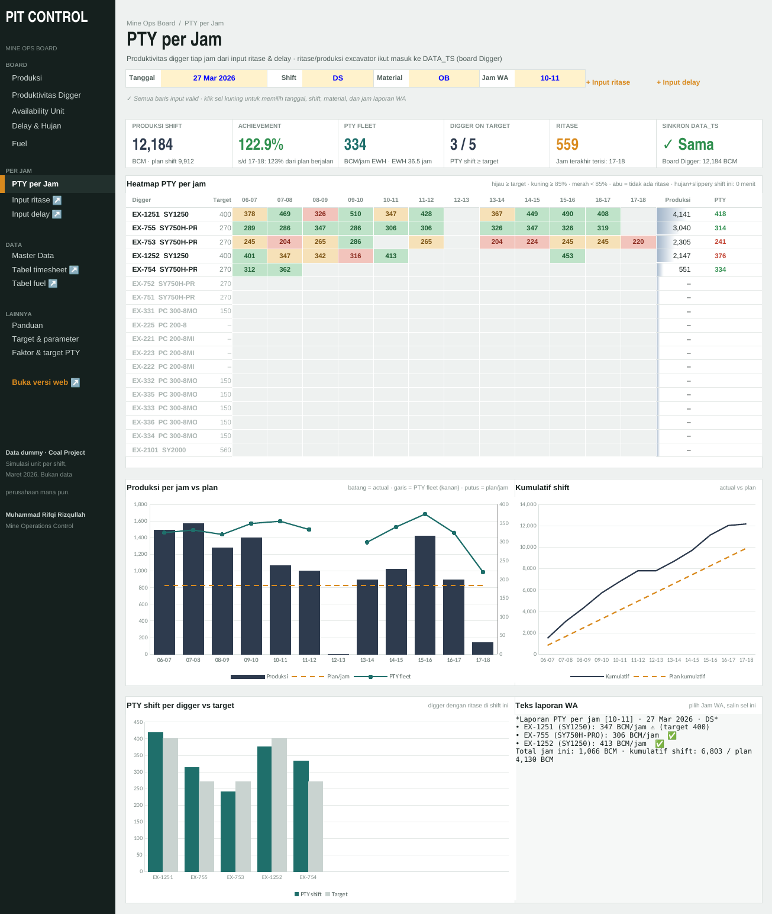

# Pit Control Board

Dashboard operasional tambang batubara untuk Mine Control Room / Mine Operations Control.
Tersedia dalam dua bentuk: **web** (buka langsung di browser, termasuk HP) dan **Excel** (siap dipakai harian).

**Buka dashboard:** halaman web repository ini (GitHub Pages)
**Unduh Excel:** [Pit_Control_Board_Demo.xlsx](Pit_Control_Board_Demo.xlsx)

## Isi dashboard
| Halaman | Isi |
|---|---|
| Produksi | OB & coal actual vs plan, achievement kumulatif, stripping ratio, kontribusi digger |
| Produktivitas Digger | PTY excavator (BCM/jam EWH), tren harian per digger |
| Availability | PA, UA, MA, EU per class & unit, Top 10 breakdown |
| Delay & Hujan | Pareto idle, jam hujan vs achievement |
| Fuel | Fuel ratio Mining vs All, konsumsi per kategori & tipe alat |
| Tren PTY | Heatmap PTY harian per digger, ranking & % shift on target |
| PTY per Jam | Heatmap PTY digger per jam, produksi per jam vs plan, teks laporan WA |
| Fleet & Delay | Match factor digger–DT per jam, saran tambah/kurang DT, menit hilang per kategori |
| Daily Report | Produksi DS/NS/harian/MTD vs plan, per jam 24 jam, per digger & per hauler |

## Rumus utama
- **PA** = (HM + Idle) ÷ (HM + Idle + BD) · **UA** = HM ÷ (HM + Idle) · **MA** = HM ÷ (HM + BD) · **EU** = HM ÷ (HM + BD + Idle)
- **PTY digger** = produksi ÷ EWH; EWH per jam = (60 − delay unit − delay umum) ÷ 60
- **Produksi** = ritase × faktor BCM/rit per material × tipe DT
- **Fuel ratio** = fuel (L) ÷ (OB BCM + coal MT ÷ 1,3)
- **Match factor** = Σ (waktu muat 1 DT ÷ cycle time DT teoritis)

## Alur data (Excel)
Input ritase & delay per jam → PTY per jam, match factor, daily report → ritase & produksi excavator otomatis masuk ke data timesheet harian → semua board.
Input dilengkapi validasi: delay maksimal 60 menit per jam, unit harus terdaftar, baris bermasalah ditandai merah.

> Semua angka adalah **data dummy hasil simulasi**, bukan data perusahaan mana pun.

---
Disusun oleh **Muhammad Rifqi Rizqullah, S.T.** — Mining Engineer · Mine Operations Control
[LinkedIn](https://www.linkedin.com/in/muhammad-rifqi-rizqullah-916aa51ba)
